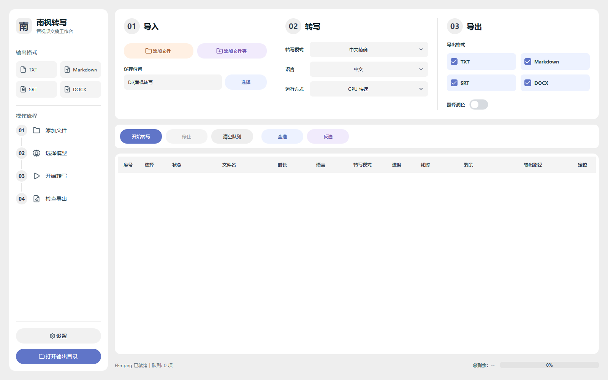
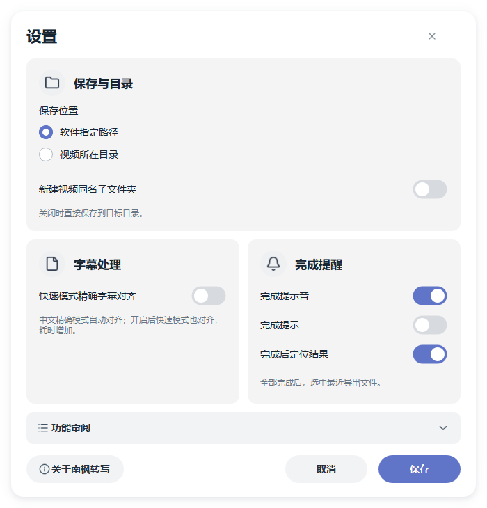

# 南枫转写

面向影视、动画与 VFX 工作流的本地优先批量音视频转写工具。项目基于 Python、PySide6、faster-whisper 和 FFmpeg，支持 Windows 本地转写、GPU/CPU 自动降级、批量队列与多格式导出。

## 软件界面预览

Windows v1.0.6 当前构建运行截图，主窗口 1600×1000。





## v1.0.6 更新

- 页面改为纯浅灰底，内容采用无描边白色分区，输入框使用浅灰填充。
- 按钮保留颜色：柔和蓝色主操作、浅橙/浅紫导入，以及红色停止提示。
- 设置、开关、导出勾选与模式菜单采用清晰的选中状态，移除绿色主题强调。
- 操作按钮圆角与高度统一，队列使用完整的圆角白色工作区。
- 沿用精简安装包和按需安装的独立本地模型运行环境。

## 功能

- 批量添加视频、音频或整个文件夹，也支持拖放导入。
- 两种本地转写模式：中文精确（Qwen3-ASR-1.7B）与通用快速（Whisper large-v3-turbo），默认中文精确。收起的输入框只显示中文名；展开下拉列表后，各选项在中文名下面显示实际模型名，悬停查看功能差异。
- 字幕使用固定 Qwen3-ForcedAligner-0.6B 对齐器：中文精确导出 SRT 时使用；通用快速可在设置开启“快速模式也使用精确字幕对齐”。总共两套识别权重和一套对齐权重。
- 支持 GPU 快速和 CPU 稳定模式；GPU 环境不可用时可回退 CPU。
- 同一批任务复用模型，GPU 模式支持批量推理和资源不足时逐级降级。
- 每个 Whisper 模型只需成功下载一次，默认长期保存在 `%LOCALAPPDATA%\NanfengTranscriber\models`，升级或重装软件仍会复用。
- 导出 TXT、Markdown、SRT、DOCX。
- 可选调用文本 API，将转写稿翻译、整理为现代简体中文。
- 显示逐项状态、进度、耗时、剩余时间、输出路径和总进度。
- 已有结果可选择覆盖，或跳过后继续处理剩余任务。
- 保存位置、模型、语言、GPU/CPU 模式、导出格式与翻译润色开关会在重启后恢复。
- 每条任务可直接定位源媒体或实际导出文件；批次结束后显示按成功、失败、跳过和停止分色的结果摘要。
- 可在“设置”中开关完成提示音、完成提示，以及全部成功后自动在资源管理器中定位最近导出的文件。
- 无音轨、静音或仅含画面的视频会明确标记为“无文字”；其他 FFmpeg 提取错误会显示可操作原因。

## Windows 安装

从 GitHub Releases 下载 `NanfengTranscriber-Windows-v1.0.6-Setup.exe`，双击安装。Release 提供安装程序本体及 SHA-256 校验；安装说明以本 README 为准。

主安装包不包含 PyTorch/CUDA 或模型权重。首次使用中文精确或快速模式精确字幕时，软件提示安装独立运行环境，下载进度在安装窗口显示；完成后重新开始转写。环境保存在 `%LOCALAPPDATA%\NanfengTranscriber\runtimes\qwen`，依赖占用数 GB，但升级软件时不会重复安装。识别及对齐模型首次使用时另行下载，之后在本地缓存复用。

Windows 安装包未签名，系统可能显示未知发布者提示。

## 源码运行

中文精确使用独立的本地 Python 运行环境。首次运行 `安装中文精确运行环境_Windows.bat` 安装依赖，再运行 `测试最新设置_Windows.bat`。环境位于项目 `.runtime/qwen`，也可通过 `NANFENG_QWEN_PYTHON` 指定已有环境的 Python。模型首次下载后保存在用户级缓存，后续离线复用；语音推理和字幕对齐不上传音频。

旧版本 Whisper 选择自动迁移为通用快速；旧缓存不再作为可选模型加载。日语精确字幕额外需要 `nagisa` 分词依赖，未安装时请使用快速模式的原生时间戳；精确字幕失败会提示原因，不伪造对齐时间。

历史版本见 GitHub Releases；当前版本状态见 [PROJECT_STATUS.md](docs/PROJECT_STATUS.md)。

环境要求：Python 3.11+、FFmpeg/FFprobe，以及 NVIDIA GPU 可选运行库。

```powershell
python -m pip install -r requirements.txt
python -m unittest discover -s tests -v
python start.py
```

Windows 也可双击 `启动南枫转写_Windows_源码测试.bat`。本地模型文件、日志、构建目录和安装包不会提交到 Git。

## 翻译与润色

“翻译润色”是可选的联网能力，需要配置 `NANZHU_TEXT_API_KEY` 或 `OPENAI_API_KEY`。未配置密钥时，软件只执行本地原始转写，不会上传音视频文件。

API 鉴权失败、请求超时、空响应和异常响应格式均有独立错误提示；错误信息不会回显 API Key 或服务端原始响应。

## 当前验证状态

- 自动化测试覆盖已有结果续跑、API 鉴权/超时/空响应、模型持久缓存、设置记忆、逐项定位、结束反馈、Inno 安装器合同和四档 DPI 截图基线。
- Windows RTX 4090 固定三样本基准中，队列耗时从 130.499 秒降至 28.403 秒。
- macOS 版本尚未实现；迁移要求见 `docs/MAC_CODEX_START_PROMPT.md`。
- 当前技术栈、目录结构与工程事实见 `docs/context.md`；正式经验审计见 `docs/development-experience-audit.md`；动态开发状态见 `docs/CURRENT_HANDOFF.md`；产品与历史经验见 `docs/chatgpt-project-context.md`。

## 许可证

当前仓库未附开源许可证，版权及使用权由项目作者保留。
